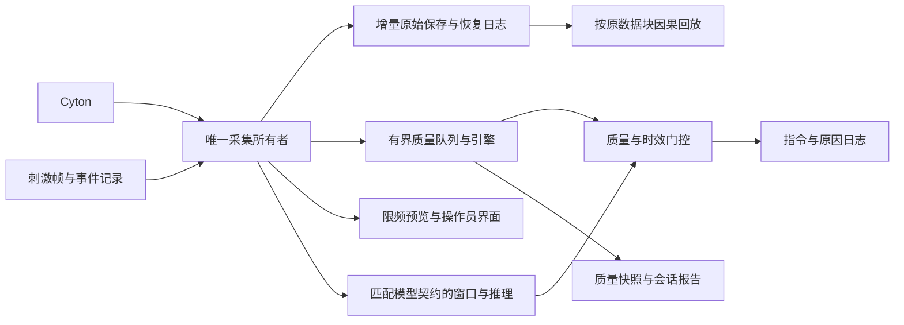

# NeuroStation 项目改进与开发执行报告

编制日期：2026-11-03（Asia/Shanghai）  
适用工作区：F:/脑机采集/NeuroStation  
交付状态：改进与开发执行报告；明确后续由我完成的代码修改及验证要求。下列开发项当前均为待实施，完成情况将按实际代码和测试记录更新。  
建议版本目标：沿用已有 1.05 / 1.0.5 正式版建议；当前本地 pyproject.toml 仍为 1.0.4，本次不变更版本号。

**执行方式：由我依据本报告逐项完成代码修改、必要测试、问题修复和交付文档。执行依据是代码依赖及验证结果。**

**改进主线：可信采集 → 有状态处理与质量标记 → 操作员界面与报告 → 可拒判的指令输出 → 回放和实机验收。** 优先把已有模块连接成能够复现、解释和验收的系统，再推进新的个人模型。正式软件版本、信号质量通过和模型个人验证是三个独立状态。

本文承接《NeuroStation-1.05-实时信号质量优化方案.md》的质量规格，补充 BrainAssistant 对比得到的工程借鉴、当前源码差异、修改内容、执行顺序、完成条件和验证要求。旧《下一阶段任务计划.md》保留历史实施记录；其早期 MVP 表述不作为本轮发布要求。具体质量指标定义沿用 1.05 方案，冲突时以本次核实的源码事实、项目 AGENTS.md 和本轮冻结的契约为准。

## 1. 对比结论怎样转化为本项目任务

对比来源为聊天“对比脑电项目可借鉴之处”的可读取记录，以及 2026-11-02《BrainAssistant EEG 静态与动态分析汇总报告》。报告主要证明原版函数在受控测试中的行为；其真实设备采集与 GUI 全链路覆盖有限。以下借鉴均在 NeuroStation 中独立设计和验证，不把对方参数直接当作本项目的合格标准。

| 借鉴点 | 对比支持的事实 | NeuroStation 的实施动作 | 优先级 / 任务 |
|---|---|---|---|
| 滤波链与预设 | 存在带通、工频预设、跳过与复用路径 | 建立版本化处理配置，明确用途、相位、通道、单位、预热和模型输入要求 | P0 / NSX-006 |
| 分块状态连续 | 同一滤波链保留状态时，所测分块与整段一致 | 把整段因果处理与任意分块的等价性变成自动验收；断流必须切换流段并重置 | P0 / NSX-003、006 |
| 多种伪迹检测互补 | 绝对幅度与窗口幅度变化检测行为不同 | 保留已有 robust-z、平线、运动检测；补上可配置的绝对幅度、峰峰值、突变和规则覆盖率 | P0 / NSX-007 |
| 伪迹区间可解释 | 自动检测形成区间，清理函数可返回新序列 | 保存原因、通道、样本区间和规则版本；分析按掩码剔除，原时间轴保持完整 | P0 / NSX-002、007 |
| 缓存与重复处理管理 | 处理结果存在缓存和完成标记 | 加强本项目已有缓存的实现版本绑定、派生文件校验、原子完成和并发保护 | P0 / NSX-009 |
| 边界反例驱动验证 | 特定 100 Hz 用例出现尾部 24 点及短片段漏检 | 增加逐点尖峰扫描、短段、末尾不足窗、跨块伪迹、阈值等号及区间合并测试 | P0 / NSX-007、013 |
| 指标口径独立复算 | 基频增益和整体 RMS 增益有不同含义 | 分开报告工频衰减、全带 RMS、目标频带变化和任务指标；不得用单个衰减值代替质量结论 | P1 / NSX-011、013 |

暂不纳入本轮主线：ICA/EOG 自动扣除、自动改变电极参考、自动修复长缺口、更多设备协议和复杂神经网络升级。对比报告没有确认对方 ICA/EOG 扣除能力，本项目也不以名称或界面线索推导这些能力。50/60 Hz 及谐波陷波是否启用，由本地配置、任务频带和验证结果决定；不自动把两套工频和所有谐波叠加。

## 2. 以当前代码为准的改进清单

本地 HEAD 为 8697608303bdf4d5f1a84454e0837fb8f647df88，工作区存在未提交修改和未跟踪文件。HEAD 不能单独表示本文所审查的源码；附录保存关键文件 SHA-256。下表是源码阅读结论，未在本次重新执行功能或硬件测试。

| 当前能力 / 位置 | 已确认状态 | 本轮要补的内容 |
|---|---|---|
| apps/workstation_ui/components.py::_OpenBCIDisplayFilter | 已有逐通道、有状态显示滤波，组合 5–50 Hz 和 50/60 Hz 陷波 | 抽出可测试实现及用途配置；缺失值不能在界面上变成看似正常的连续信号；显示滤波不自动成为模型输入 |
| eeg_tools/denoise.py::_filter_track | 已有离线 SOS 双向滤波及 50/60 Hz 两条派生轨 | 保留独立的离线零相位身份；新增在线因果路径和回放，不要求因果与双向输出逐点相同 |
| eeg_tools/denoise.py::_analyze_array | 已计算 artifact_rejected，但呈现匹配率和注视标注匹配率仍从全部对应行聚合 | 新增全试次、质量通过试次、拒判试次的独立统计和分母；旧字段兼容并说明含义 |
| eeg_tools/denoise.py::_detect_artifacts | 已有非有限、平线、robust-z、频带比和运动标记；高频检测会跳过不足最小长度的片段 | 增加各规则 assessed/insufficient 状态；局部规则处理短段，频谱数据不足明确未知；用末尾测试核查覆盖，不能把对方漏检直接认定为本项目同一缺陷 |
| eeg_tools/denoise.py::_cached_result | 已按输入哈希和配置文件哈希命中，并检查输出文件存在 | 命中分支补验派生清单及内容哈希、schema 和实现版本；有效配置默认值也进入身份；现状不等同于已证实发生数据损坏 |
| workstation/acquisition_worker.py::_LiveWaveformWriter | 取最近 512 点快照，并按时间戳筛选；其计数是预览计数 | 主采集入口改为唯一读取者的增量数据块；预览保留独立水位线；不据此声称原始记录已发生丢样 |
| workstation/acquisition_worker.py 结束路径 | 结束阶段调用 get_board_data；已有 marker 到样本索引的关联 | 前移到持续取块与持续落盘，并保存事件关联证据；避免只靠结束时读取与事后推定 |
| workstation/process_gateway.py::read_live_waveform | 当前主要向 UI 返回通道、采样率和 samples | 传递真实接收索引、包号、时间来源、流段和缺口，区分保存水位与预览水位 |
| eeg_tools/realtime_capture.py + realtime_commands.py | 独立程序已有连续增量保存、包号/索引检查、5 秒窗口、1 秒步长、断流重置与过期关联 | 提炼可复用能力，补质量契约与恢复日志；迁移时保留这些现有行为和测试 |
| realtime_command_inference.py + matched_ssvep_decoder.py | 8×1250 输入；线性去趋势、Hann、72 特征；归一化频带为 6–90 Hz；已有 OOD/置信门控 | 输入处理链绑定模型元数据；未经重新验证不得把 1–45 Hz 波形直接送入原模型 |
| configs/personal_ssvep_decoder_v4.json | 正式配置，但仍为离线候选；runtime_enabled、production_validated、default_deployment_authorized 均为 false | 在独立校准/验证/测试流程中评估；旧个人迁移或 v14 失败记录保持原结论 |
| monitor_model.py / monitor.py | 已有原始均值、AC RMS、峰峰值、无效值及操作员窗口 | 扩展工频、漂移、伪迹时间轴、质量原因、处理轨与更新时间，不另造第二套含义不同的质量分数 |

**第一批应先处理的四件事：统计口径、数据身份与采集所有权、滤波/模型契约、质量覆盖与边界测试。** UI 扩展依赖这些事实源；更换模型不能替代它们。

## 3. 交付范围与不变量

本轮 1.05 工程交付包含：统一数据块与增量保存、实时质量核心、处理配置和缓存、操作员界面、试次及会话报告、历史回放、已有独立指令程序的质量接入，以及正式打包验收。新的个人模型作为独立研究支线，不阻塞质量工作站发布。

实施必须保留以下约束：

- 真实原始 BrainFlow 行、标记、时间信息完整保存；不补零、删点、覆盖原始 EEG。派生数据保留与原始采样位置的映射。
- 所有正式协议仍为 status: formal；完整通道校验、硬件预检、显示预检、光敏风险确认和紧急停止继续有效。模板不冒充实际接线记录。
- 有效配置、物理接线确认、实测阻抗和硬件光学同步分别记录；没有实测证据时使用“未测/未核实”。
- 模型前向输入不含呈现目标、期待指令或测试标签。呈现目标、人工/自报注视、独立真值和算法推断保留各自来源。
- 旧会话、旧 manifest 和历史验证结论只读；重新计算写入新的 derived 目录。旧 ok 不显示为新版信号质量通过。
- 产品不新增模拟采集入口。合成信号和 fake 设备用于测试；历史回放明确标记用途。
- 同一串口只允许一个采集所有者。主工作站与独立指令程序共享实现，但仍以互斥设备锁防止同时占用。
- 原始 EEG、个人身份和会话数据默认本地保存；开发证据使用去身份化摘要或受控的本地路径。

## 4. 目标架构及迁移办法




上图中各消费者拿到同源数据；展示可限频，原始落盘不可静默丢块。BrainFlow 官方 API 区分非消费快照 get_current_board_data 和消费缓冲的 get_board_data，因此采集读取由唯一所有者负责。[E3]

**迁移顺序：**先新增契约和核心，在测试/历史回放中跑通；再让独立指令入口使用适配器并保住既有行为；最后切换主工作站的取块与保存路径。影子比较从同一已读数据块分发，不同时启动第二个 BoardShim 或第二个缓冲读取者。每次只迁移一个入口，保留上一正式包作为恢复选择。

建议新增模块如下，均为规划路径：

| 新模块 | 职责 |
|---|---|
| eeg_tools/streaming/contracts.py | SampleBlock、事件关联、版本校验和兼容适配 |
| eeg_tools/streaming/acquisition.py | BoardShim 生命周期、唯一读取、设备锁、marker 命令、数据块分发 |
| eeg_tools/streaming/recorder.py | 增量原始记录、块校验、持久化水位、封存与恢复 |
| eeg_tools/quality/contracts.py、integrity.py | 质量状态、规则覆盖、包号/时间证据和缺口分类 |
| eeg_tools/quality/filters.py、metrics.py | 有状态因果滤波和多窗口指标 |
| eeg_tools/quality/artifacts.py、rules.py、engine.py | 伪迹区间、冻结规则、告警状态机及窗口可用性 |
| eeg_tools/quality/summary.py、replay.py | 试次/会话聚合与确定性回放 |
| eeg_tools/processing_cache.py | 输入/配置/实现身份、缓存校验和原子发布 |
| configs/quality_v1.json、configs/processing_profiles_v1.json | 版本化质量规则和处理预设 |

### 4.1 数据契约先冻结

SampleBlock 最低字段：schema_version、session_id、stream_id、generation、block_id、received_sample_start、sample_count、sample_rate_hz、channel_names、units、eeg、package_numbers、timestamps_s、timestamp_source、host_received_monotonic_s、marker、discontinuities、channel_mapping_hash、device_settings_hash。

索引统一使用零起始、左闭右开区间；已有实时窗口的 sample_end 为包含末点，必须通过具名版本适配转换，不能直接改变旧接口含义。received_sample_index 只说明收到的顺序；包号和时间证据另外描述连续性，不能把接收索引连续等同于设备绝无漏样。

同一流段的时间域固定。设备原始时间、BrainFlow 时间、主机单调时钟、显示 frameSwapped 时钟分别记录来源；未经校准不直接相减声称物理延迟。8 位包号回绕、设备重启与长时间中断分别处理；无法确定丢失数时记 unknown，不填造出的样本。

持久化至少区分 received / written / durable / assessed / previewed 水位。flush 与已持久化不能混同；持久化周期、原子封存和恢复边界通过进程故障测试测量，突然断电能力另行声明。

### 4.2 滤波共用实现，配置由用途决定

预设至少包含 raw、display_legacy、quality_online、offline_zero_phase、model_locked。每个预设记录采样率、通道/单位、带通、陷波、阶数定义、SOS 系数哈希、相位模式、初始化/预热、缺口策略、实现版本和适用范围。滤波阶数必须写清单个设计和串联后的含义，不能只照抄现有类注释。

在线链采用因果 SOS，并把上一块最终状态传给下一块；SciPy 的 sosfilt 提供 zi/zf 状态接口。双向离线处理使用独立 profile，不称为在线同等输出。[E1][E2] 无效值和长缺口切断处理段并重置/预热；不能通过插值长缺口把两段未知数据悄悄连起来。短缺口的离线插值若保留，必须产生修复掩码，不能反向成为有效采集样本。

现有公开模型继续绑定原 spectral_features 前处理。其 6–90 Hz 分母会被 1–45 Hz 带通改变；任何新增滤波、参考、通道选择、归一化或窗口长度，都产生新的处理身份并要求相应模型重验证。显示切换不影响模型输入。display_legacy 的连续有限输入保留回归基线，缺失区间则用掩码断线呈现。滤波预热长度依据各预设的稳定时间测试确定，不能把已有1秒刺激过渡直接当成所有滤波器的预热时间。处理配置在一次采集/模型流段中冻结，变更创建新 generation 并清空旧窗口和待返回预测。

### 4.3 质量检测及拒判

规则分为原始完整性、原始幅度/轨限、频谱污染、任务证据四类。原始污染不能因显示滤波后变小而消失。每条规则输出 assessed / insufficient_data / unavailable，并附样本区间、通道、数值、阈值、单位、规则版本和原因。

新增绝对幅度、窗口峰峰值、突变规则；沿用并校正已有平线、robust-z、运动和高频比定义。阈值先作为冻结的工程候选，附适用硬件和数据依据；对比报告的“阈值 100”没有可直接移用的单位证据。高频比与 SSVEP 谐波频段可能重叠，任务模式下需按预先声明的目标/谐波配置解释，不能见到 30 Hz 能量就直接断言肌电伪迹。

对短片段，能评估的幅度规则继续评估；频谱等规则数据不足时明确未知。伪迹区间统一 [start,end)，跨块延伸、尾部 flush、边界裁剪、同类合并和多原因并存必须有确定规则；在线规则不读取未来样本。只有完整在线过程和尾部收敛使用同一策略时，回放结果才要求一致。

指令门控在现有窗口、关联、OOD 和置信机制上增加 quality、freshness、processing_hash 检查。质量不明/异常、重置、超时和配置不匹配均输出 UNKNOWN，并记录原因。MOVE 类可保留有效期续期；SELECT 增加可配置的一次触发、释放后重新布防或冷却策略，避免每个重叠窗口重复触发。连续确认窗口高度重叠，不作为独立正确率样本。默认仍不执行外部设备动作，实验模型标志保持真实。

### 4.4 统计与缓存

报告同时提供 all_trials、quality_eligible_trials、accepted_trials、rejected_trials，写明每个集合的数量、有效时长、标签来源和分母。all_trials 以已记录的试次起始事件建立账本，计划试次数另列；中止、缺结束事件、无法评分均保留记录及原因，不能在计算异常后悄悄跳过。accepted_trials 是质量合格且模型接受的子集；质量拒绝、模型拒绝和无法评估分开计数，避免将重叠集合相加。质量筛选条件先冻结，不按预测是否正确筛选试次。无标签、没有可接受试次或未完成评估时返回 null/unknown，而非 0% 或 100%。旧 presented_target_accuracy 字段可保留兼容，但界面解释为“与呈现目标的匹配比例”。

缓存身份包括原始输入清单、完整生效配置（含默认值）、schema、实现版本/源码指纹、依赖版本、通道/单位/参考、相位、规则版本；包含模型时再绑定权重和前处理哈希。命中时校验输出清单与文件内容；发现损坏标记 invalid 并写新派生运行，不覆盖原始记录。临时目录完成后原子发布，重复运行用锁/任务身份防止半成品被命中。活动流式缓存还绑定 stream_id、generation、处理边界，不能跨流段复用状态。

### 4.5 数据文件与接口交付

| 输出 | 明确用途 |
|---|---|
| raw_brainflow.tsv / raw_columns.tsv | 延续原始数据接口；新索引/附加字段通过版本化适配提供，旧读取器须回归 |
| block_journal.ndjson | 记录原始块区间、字节位置、样本数、校验、流段和已确认持久化水位；用于恢复 |
| quality.json（新会话schema v2） | 分开给出recording、assessment、integrity、signal、stimulus_timing状态及各计数；沿用1.05规格 |
| quality_config.json / processing_manifest.json | 完整生效配置、数据/实现/模型身份、相位与初始化、输入/派生清单 |
| quality_windows.tsv / quality_events.jsonl | 每窗指标及覆盖；告警发生、升级、恢复和配置/流段切换 |
| trial_quality.tsv / quality_report.html | 逐试次账本、原因与分母、工频/任务指标、来源及本地可浏览报告 |
| commands.ndjson及现有独立command_manifest.json | 兼容保留指令接口；增加版本化质量摘要/处理身份，不改写原始采集manifest |

历史会话的新质量结果统一写入 derived/quality/<analysis_id>/；原目录quality.json和其他历史产物保持原样。活动状态使用独立快照文件或有版本消息；最终报告只在完整生成后原子切换。新派生结果的“最新可用”索引可以更新，但不覆盖旧运行目录或原始清单。

## 5. 由我执行的代码修改清单

后续实现由我按下列清单推进，包括核查现有代码、编写和修改模块、补充必要测试、定位失败原因、运行回归、更新使用说明，以及整理实际验证结果。P0表示基础正确性和发布必需项，P1表示依赖这些基础的产品功能；两类都在本轮交付范围内。

任务编号用于连续记录进度。每项均需写明“修改了什么、如何验证、实际结果和剩余问题”，以证据更新状态。当前14项都是待实施；本报告本身完成不代表任务已完成。

| ID | 优先级 | 修改内容 / 主要代码位置 | 代码依赖 | 完成标准与交付物 |
|---|---|---|---|---|
| NSX-001 | P0 | 冻结基线、SampleBlock/质量/事件契约；新增 streaming/contracts.py、quality/contracts.py | 无 | 登记当前修改和环境；冻结 schema、索引/时间语义、兼容表、测试样本清单及任务验收规格 |
| NSX-002 | P0 | 修正试次统计与状态文案；denoise.py、结果适配层 | 001 | 混合有效/拒绝试次分母正确；全部拒绝返回 unknown；旧文件可读；新增统计回归 |
| NSX-003 | P0 | 提炼唯一采集所有者；realtime_capture.py、acquisition_worker.py、streaming/acquisition.py | 001 | 两个入口分别接入；单次读取多路分发；包号回绕、重复、长停顿、设备重启可解释；无新增第二读者 |
| NSX-004 | P0 | 增量保存、恢复水位和封存；streaming/recorder.py、session_files.py | 003 | 正常退出样本/哈希一致；杀进程、磁盘满、写入异常封存为 partial/error；恢复只到已验证块 |
| NSX-005 | P0 | 采样与刺激事件关联；worker、process_gateway.py、现有帧事件模块 | 003 | 事件保留 request/ack/marker/sample/frame 证据；无法匹配即 unknown；不将回调时间冒充光学起点 |
| NSX-006 | P0 | 共享因果滤波和用途预设；quality/filters.py、components.py、denoise.py | 001、003 | 因果整段/随机分块等价；缺口/切换重置；display_legacy 行为有基线；模型处理身份不被悄悄改变 |
| NSX-007 | P0 | 伪迹检测、规则覆盖和区间；quality/artifacts.py、rules.py、denoise.py | 001、006 | 逐点尖峰、短段/尾部/跨块/等号、合并裁边全部符合规格；检测不到与不可评估分开 |
| NSX-008 | P0 | 质量引擎、队列与状态机；quality/engine.py、metrics.py、integrity.py | 003、006、007 | 工频/漂移/轨限/未知可解释；处理过期自动变灰；质量消费者卡住不阻塞采集并记录未评估区间 |
| NSX-009 | P0 | 完善缓存及可复现身份；processing_cache.py、denoise.py | 001、006、007 | 改输入、有效配置、实现、相位均失效；输出篡改/缺失/半写/并发不能命中；相同输入可复用 |
| NSX-010 | P1 | 扩展操作员窗口与主界面；monitor.py、monitor_model.py、app.py、pages.py、双语文案 | 002、005、008 | 通道质量表、原始/显示轨、PSD、区间与原因、采集/持久化/评估水位可见；不遮挡或拖慢刺激 |
| NSX-011 | P1 | 试次与会话报告、旧会话适配；quality/summary.py、结果页 | 002、007、008、009 | 生成质量窗口、事件、试次、配置及本地报告；每个比例有分母；旧 ok 和 RMS 含义明确 |
| NSX-012 | P1 | 质量门控接入独立指令程序；realtime_commands.py、inference、transport 和 UI | 005、006、008 | 保留 5 秒/1 秒、generation、超时、停止约束；污染/过期必拒判；SELECT 防连发；模型实验标志不升级 |
| NSX-013 | P0 | 分块回放与故障回归；quality/replay.py、新测试/验收脚本 | 004–009；最终验收含 010–012 | 在线保存结果与同块序因果回放一致；不同块大小处理等价；原始哈希不变；旧会话迁移测试通过 |
| NSX-014 | P0 | 真机、性能、打包与发布核验；构建脚本、CI、验收清单 | 010–013 | 硬件/长稳/故障/显示证据、全部要求测试、portable 子进程退出与资源路径验证；发布证据归档 |

可在当前环境完成的代码修改、自动测试、历史数据回放和构建检查由我直接推进。实际头盔佩戴、真实屏幕呈现及硬件测量需要对应现场条件；没有实测记录的检查如实标记为“待实机验证”，不以自动测试结果替代。

## 6. 执行顺序与完成条件

执行顺序由模块依赖和验证结果决定。主依赖链为：001 → 003 → 004/005/006 → 007 → 008 → 010/011/012 → 013 → 014。002在001之后先完成；009在处理配置与规则确定后完成。013的回放样例和故障用例从001开始准备。

| 检查点 | 我需要完成的修改 | 进入后续工作的条件 |
|---|---|---|
| G0 基线与统计口径 | 001、002：记录当前源码状态，确定数据和事件字段，修正统计与兼容解释 | 字段、时间来源、统计分母明确；现有与新增相关测试有记录 |
| G1 可信采集 | 003、004、005：统一采集所有者、持续保存和样本/刺激关联 | 两个入口分别通过数据分发、完整性、异常封存和事件关联检查 |
| G2 质量处理核心 | 006、007、008、009：共享滤波、伪迹规则、质量引擎和缓存校验 | 分块一致、短段/末尾覆盖、未知状态和缓存失效行为符合规格 |
| G3 界面、报告与指令 | 010、011、012：把质量结果接入操作员界面、会话报告及现有指令程序 | 问题能定位、记录能复查、异常能拒判，旧会话与旧接口可读取 |
| G4 集成与交付验证 | 013、014：完成回放、故障恢复、性能、打包和具备条件的实机验证 | 必需自动检查通过；真实设备项目有对应证据；未验证项明确列出 |

每完成一组修改，先运行相关测试并修复发现的问题，再推进依赖该能力的后续模块。已有失败与本次新增失败分别记录。需要回到前一模块修改时，同步重跑受影响检查，不能只更新文档状态。

### 第一批具体执行内容

1. **记录代码基线。** 确认工作区已有修改及归属，核对Python、BrainFlow、SciPy和Qt环境，运行直接相关的现有测试，记录初始结果。
2. **明确输入输出。** 写出SampleBlock、质量状态、事件关联和模型前处理契约；保留旧接口适配；确定索引、时间和区间含义。
3. **修正统计。** 为全试次、质量通过、模型接受及无法评估情况建立独立统计；补充全部拒绝、无标签、中止和评分失败的测试。
4. **提炼采集核心。** 从独立实时入口复用已有连续性处理，建立唯一读取和分发实现；通过注入式fake与历史数据验证后，逐步接入两个入口。
5. **补齐保存与时序。** 实现增量保存、恢复水位、事件请求与回执；对丢包、重启、晚到事件和写入失败留下可解释记录。

这批完成后，继续实现G2的滤波与质量核心。界面、报告和模型接入使用经过验证的统一结果，避免在不同入口重新定义同一个指标。

### 每项修改完成后的报告内容

- 实际改动的文件、函数、配置和接口。
- 修复前的问题及修复后的可观察行为。
- 已运行的验证命令、输入、结果及证据路径。
- 是否影响旧会话、当前模型、实时窗口或正式配置。
- 未解决问题、尚缺的实机证据，以及下一项具体工作。

最终交付应包含修改后的源码、必要配置、测试、使用说明和实测结果汇总。完成状态以实际代码和验证记录为准。

## 7. 验收矩阵：用可观察结果决定完成

下列数值是建议的工程验收指标，需在001登记基准机和固定环境；不是既有实测结果，也不是脑电生理合格阈值。

| 验收项 | 方法 | 通过标准 / 必留证据 |
|---|---|---|
| 原始不变 | 同一历史会话执行滤波、标记、报告和重复运行 | 原始 EEG、事件、原始 manifest 哈希不变；全部新文件在新派生位置 |
| 采集分发 | fake 输入、离线块记录及真实采集各自核对 | 每个已收到原始样本恰好记录一次；各消费者缺口有独立标记；真实设备丢包另外统计 |
| 时间/包号 | 回绕、重复、跳号、重启、整周期不确定、主机校时 | 原始观测保留；不按重复时间戳删有效样本；无法确定的缺口保持 unknown |
| 因果分块 | 固定多正弦/阶跃/噪声信号，整段与固定种子的随机分块 | 同实现、同初态、同流段下 float64 输出 rtol≤1e-9、atol≤1e-8 µV；状态连续；离线双向轨不纳入此等价断言 |
| 幅度/窗口边界 | 对可评估片段逐位置放置超阈尖峰，覆盖100 Hz复审夹具和250 Hz工程夹具 | 直接幅度规则可评估点100%按冻结谓词检出；窗口规则按本项目规格无遗漏；1点峰峰值/短段频谱等不可评估项明确原因 |
| 区间与跨块 | 首尾、W−1/W/W+1、step余数、跨块、重叠、多原因 | 区间合法且长度准确；合并不越界、不吞原因；在线尾部 flush 和回放一致 |
| 规则覆盖 | 高频检测短窗、缺辅助通道、NaN、预热、消费者积压 | 未评估时长显式计入；未知不算质量通过；质量不明时指令拒判 |
| 频响与任务保真 | 多频信号 + 冻结的真实回放集；记录基频、谐波、PSD、工频、RMS | 数值满足预先冻结的profile响应范围；同时报告任务变化；单个工频衰减数值不能作为全部通过依据 |
| 统计分母 | 全有效、混合拒绝、全拒绝、无标签、重复窗口 | 各集合与分母可独立复算；无监督真值不输出监督准确率；重叠窗口不增加独立试次数 |
| 缓存 | 修改输入/默认值/实现/相位；篡改输出；中断写入；并发启动 | 该失效的都失效；半成品不命中；一致输入正确复用；原文件不被修补覆盖 |
| UI 与质量延迟 | Windows基准机，8×250 Hz；日志记录就绪/展示时间 | 数据块到波形 P95≤250 ms；窗口就绪到质量展示 P95≤1 s；指标计算 P95<100 ms；首次等待窗长另报 |
| 指令生命周期 | 断流、质量严重、停止、晚到结果、配置变化、SELECT持续高分 | 停止立即使旧代次失效；已有1秒断流、2秒结果过期及1500ms有效期约束有回归；SELECT动作策略确定且有日志 |
| 长稳与恢复 | 30分钟负载、2小时浸泡、慢盘、消费者退出、采集进程异常 | 无监视引入的未说明原始丢块；内存/队列有界；只恢复完整校验块；持久化损失窗口按实测报告 |
| 刺激影响 | 同设备交替开/关监视并比较帧分布 | 建议P95帧间隔劣化≤1ms、迟帧比例增加≤0.2个百分点；未达标限频或延期，不放宽既有刺激预检 |
| 兼容与正式包 | 旧v1会话、当前协议、双语、高DPI、双屏、portable | 旧记录可读、缺字段为未知；严格正式配置通过；资源/模型路径、子进程启动与退出、停止键均经打包验证 |

阈值与有效频带的频响范围在001/006按用途冻结。对过渡带和陷波附近不承诺“全部频率保真”；模型依赖的基频、谐波及归一化分母单独列入验证。自动回归证明软件行为符合规格，真实佩戴、硬件时序和个人识别表现依靠相应现场证据。

## 8. 模型研究支线及启动条件

G2通过、完整原始/时序/质量记录可回放后，再开始新的模型比较。软件质量版本先完成工程发布；个人模型只有自己的证据门禁通过，才改变自身部署状态。

| 支线任务 | 实施内容 | 进入下一步条件 |
|---|---|---|
| A1 冻结实验 | 明确3目标还是4目标；目标频率、通道、窗长、预处理、负例、标签来源、主要指标和停止规则形成 experiment_lock | 不把当前10/12/15 Hz公开模型宣称为20 Hz模型；校准/验证/测试数据及用途事先隔离 |
| A2 补独立数据 | 至少安排不同日期的校准、验证、测试会话作为首批个人研究；沿用既有刺激/中止流程并纳入静息/非指令片段 | 三次会话仅是初步数据设计，不自动满足发布所需统计把握度；每类数量、负例时长和精度需求在采前冻结 |
| A3 透明基线比较 | 在同一切分上比较冻结FFT、适配在线前处理的CCA候选和既有MLP；先完成输入一致性，再研究增强 | 不能把现有离线零相位CCA直接改名为实时模型；不在最终测试集调阈值或挑选模型 |
| A4 独立评估 | 全试次正确率、接受后正确率、覆盖率、混淆矩阵、每分钟误触发、UNKNOWN比例和端到端延迟 | 报告试次/会话层面的置信区间和样本量限制；无独立注视真值时只作相应来源的匹配评估 |
| A5 决定是否部署 | 检查原始信号/任务保真、质量异常拒判、独立验证和实时性能；生成新的模型/处理manifest | 逐项达到A1预先冻结的数值标准；证据不足或失败继续离线，不改旧模型失败结论、不解除原有默认禁用标志 |

A1的数值发布标准需由任务目标和先导验证确定，并在最终测试前锁定；本文不根据现有两份个人记录编造可达到的准确率。可优先评估“固定窗长下误触发和拒判是否可用”，再考虑缩短5秒窗口。训练更深模型、增加GPU投入或追求单次更高置信度不作为先行交付物。

如要加入真实外部控制，需另立输出接收端任务：会话/事件去重、过期停止、失联停止、SELECT一次性动作及可见中止。现阶段文档中的command输出与实际执行仍分开记录。

## 9. 验证命令、证据目录和发布门禁

以下命令供后续实施使用，均从 F:/脑机采集/NeuroStation 运行；本次修订报告未执行这些软件测试，也未构建软件。


```powershell
python scripts/validate_release_configs.py
$env:QT_QPA_PLATFORM = 'offscreen'
python -m unittest discover -s tests -p 'test_denoise.py' -v
python -m unittest discover -s tests -p 'test_realtime_*.py' -v
python -m unittest discover -s tests -v
python -m unittest discover -s apps/workstation_ui/tests -v
python -m compileall -q apps eeg_tools tests scripts workstation.py check_cyton_live.py run_ssvep_session.py neurostation_contract.py neurostation_display.py
python scripts/smoke_ui_matrix.py
```

处理契约和实际改动对应的测试先跑；达到阶段门禁后执行完整核心/UI/正式配置检查。构建脚本继续在构建前检查正式配置；portable smoke使用现有 scripts/smoke_packaged.py 并按其帮助与构建产物路径运行。CPU核心环境与ML环境分别登记依赖和skip原因；不因缺BrainFlow/PySide6/Torch而把未运行项目算通过，也不因查阅新版在线文档顺手升级现有依赖。

建议每批验收输出到 analysis_outputs/quality_upgrade_20261103/<task_id>/<run_id>/，发布集合写入 release_acceptance/<version>/<run_id>/（均为规划目录，敏感原始数据不放入可提交产物）。最低证据：

- environment.json：OS、CPU、Python/Qt/BrainFlow/SciPy/模型依赖、源码身份、设备/显示条件。
- acceptance.json：task_id、检查项、pass/fail/unknown/skipped、原因、输入/输出哈希和证据路径。
- relevant_tests.log：相关自动检查；后期附完整核心/UI/打包日志。
- replay_comparison.json：块划分、初始化、数值误差、缺口/区间/统计对照。
- hardware_acceptance.md：现场操作者、配置、时间、故障注入、限制及未完成项目。
- performance.json：分位延迟、窗口等待、负载/内存/积压、监视开关帧分布。

任务只有“实现提交 + 相关检查 + 验收证据 + 文档/兼容说明”齐备才能标done。主线发布要求014完成且没有未解释的失败；缺实机记录的版本保持开发验证状态，正式配置通过不能替代硬件验收。个人模型未通过不阻止工作站质量版本发布，但界面和功能必须保持其实际实验/禁用状态。

## 10. 变更与恢复策略

- 迁移前保留上一正式包、配置快照和原始会话。每次只切一个入口；设备占用、落盘或停止异常时中止现场会话并封存，恢复在新会话中进行。
- 原始写入失败优先停止刺激和采集并封存已知部分；质量计算失败可以继续保存原始数据，质量变为unavailable，相关指令输出UNKNOWN。
- 推理或显示故障不能拖死唯一采集者。队列溢出前有明确降级/停止策略，缺口进入日志，不靠无限队列掩盖问题。
- 滤波/质量/模型配置均可回到上一个已验收版本；回退创建新处理运行/流段，不修改历史派生文件来伪装一致。
- 范围扩大（新设备、参考方案、新模型、外部控制）单列具体修改及验证要求。已有工作区改动先辨认归属，实施时只提交本任务相关修改。

## 附录 A：本次依据与事实边界

本地材料：

1. 用户引用聊天“对比脑电项目可借鉴之处”，thread_id=01a19cfc-1774-76c2-8514-f8758ceb5969；已通过read_thread读取可返回记录。聊天中的历史路径不作为当前工作树位置。
2. [BrainAssistant 静态与动态分析汇总报告](D:/牛逼点的东西/BrainAssistant_静态与动态分析报告_2026-11-02.md)：重点为第4节受控动态结果、第5节独立复审；本次没有重新运行对方程序或探针。
3. 本项目 AGENTS.md、README.md、pyproject.toml，以及第2节列出的实际源码和现有测试。
4. [既有1.05质量规格](F:/脑机采集/NeuroStation/docs/NeuroStation-1.05-实时信号质量优化方案.md)：质量字段、指标、状态、产品流程和性能指标来源；本文补充由我落实的代码修改与完成标准。
5. docs/NeuroStation-独立实时脑电指令应用.md、configs/personal_ssvep_decoder_v4.json、docs/NeuroStation-v14-personal-diagnostic-20261014.md：当前独立入口及历史模型能力边界，不能跨版本泛化为所有模型最终结论。

外部技术依据（2026-11-03核查官方文档；只引用API语义，不要求升级到在线文档展示的版本）：

- [E1] SciPy Reference：scipy.signal.sosfilt，zi初始状态和zf最终状态接口。
- [E2] SciPy Reference：scipy.signal.sosfiltfilt，前后向SOS处理及填充约束。
- [E3] BrainFlow User API：get_current_board_data为非消费快照，get_board_data读取并清空相应缓冲数据；以项目锁定版本的实际行为再做能力回归。

## 附录 B：关键文件身份

以下SHA-256绑定本次阅读的本地文件字节，不代表这些文件已提交、测试或发布。若后续文件变化，001需重建基线并复核相应任务假设。

| 文件 | SHA-256 |
|---|---|
| pyproject.toml | dbd9d6a65c0d8f391083e2ba586fdbe40f46e471f74bdb483f4103bfc4a551a8 |
| AGENTS.md | 84d4b14143c09e1e1a97fe24ed618867344a25a13e48fdac5a37bf62d387ac21 |
| apps/workstation_ui/components.py | a62ffa230b0ccb4dd506b87b7b60410fe56abed9c8a05e284668460d74ec1dc7 |
| eeg_tools/denoise.py | a6592bee787ef1b9356243b8144f2ee70a99f24edab49adbc82dfa83b8ee66d6 |
| eeg_tools/realtime_commands.py | 1a151842de8d3abda23933f119dcdde3ebc93284d4a178632390db65f45aa324 |
| eeg_tools/realtime_capture.py | b3616c74d49f3483a812a28ce1a298d68c191b25e3c0608ef9270dea214d0087 |
| eeg_tools/realtime_command_inference.py | f5c7d4d99dfa9ca98e6362426ad3c1e22907a8bfe18d53c3bbe2a66808fbd97e |
| eeg_tools/matched_ssvep_decoder.py | 016292f3415b843630d3cae1ba5a23431d3d7f3e06da8c71707ccb67e126770a |
| eeg_tools/workstation/acquisition_worker.py | 1ff2349a15953822202874ee6e66645649a55fa4343e8cc090af8dbad3653778 |
| eeg_tools/workstation/process_gateway.py | b0b7858af739baa488844bb22f5a3b71611178c89e758cd4d8ab171311586d0b |
| docs/NeuroStation-1.05-实时信号质量优化方案.md | a375777c1e0bb56486a062943a46e277c0f91b61c3837f23ebd39991e6d85ff7 |
